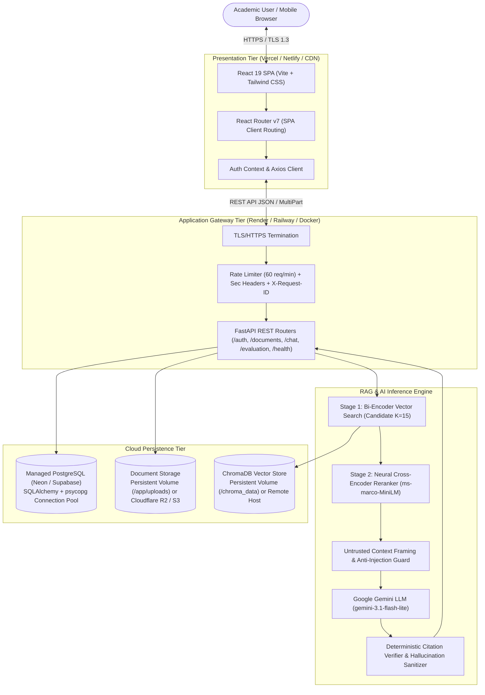

# DocuRAG: AI-Powered Intelligent Document Question Answering System Using Retrieval-Augmented Generation (RAG)

[](https://www.python.org/)
[](https://fastapi.tiangolo.com/)
[](https://react.dev/)
[](https://www.trychroma.com/)
[](https://www.postgresql.org/)
[](https://ai.google.dev/)
[](https://tailwindcss.com/)
[](LICENSE)
[]()

---

## 1. Overview
**DocuRAG** (academic title: **AI-Powered Intelligent Document Question Answering System Using Retrieval-Augmented Generation**) is an enterprise-ready, academically rigorous document question-answering platform built upon a multi-stage Retrieval-Augmented Generation (RAG) architecture.

It enables authenticated users to upload complex PDF documents (research papers, technical specifications, legal contracts), extracts page-by-page text, segments text into overlapping chunks while preserving provenance metadata, generates dense semantic embeddings in ChromaDB, applies cross-encoder neural reranking, and synthesizes hallucination-controlled answers with verified inline page citations using Google Gemini.

---

## 2. Features
- **Multi-Document RAG**: Query across a single document, a user-selected subset of documents, or all uploaded documents.
- **Two-Stage Retrieval & Reranking**: Bi-encoder vector search (`all-MiniLM-L6-v2`) followed by Cross-Encoder neural reranking (`ms-marco-MiniLM-L-6-v2`) for state-of-the-art precision.
- **Verifiable Inline Citations & Evidence Drawer**: Every factual statement is backed by clickable inline citations (`[1]`, `[2]`) that open a slide-out evidence drawer with highlighted excerpts and source metadata.
- **Persistent Chat History & Session Memory**: Multi-session conversation management with contextual pronoun rewriting and memory.
- **Research Evaluation Suite**: Empirical evaluation against a 60-question gold standard dataset with live visualization of Precision@K, Recall@K, Hit Rate@K, and MRR.
- **Enterprise Security Hardening**: Strict multi-tenant user isolation, server-side IDOR defense, sliding-window rate limiting, distributed request tracing (`X-Request-ID`), path traversal protection, and prompt injection defenses.
- **Cloud-Ready & Persistent**: Dual-dialect database support (PostgreSQL in production, SQLite in development), S3-compatible cloud object storage (Cloudflare R2, AWS S3), and remote ChromaDB support.

---

## 3. Architecture



---

## 4. Technology Stack

- **Frontend**: React 19, Vite 8, Tailwind CSS 3.4, React Router v7, Recharts 3.10, Lucide Icons, Axios.
- **Backend**: FastAPI 0.110+, Uvicorn (ASGI), Pydantic v2, PyMuPDF (fitz), Python 3.10+.
- **Database & ORM**: PostgreSQL (production), SQLite (local development / testing), SQLAlchemy 2.0, `psycopg` v3, `aiosqlite`.
- **Vector Database**: ChromaDB 0.4.24 (HNSW with Cosine Distance).
- **Embeddings & Neural Reranker**: `sentence-transformers/all-MiniLM-L6-v2` (384-dimensional dense vectors), `cross-encoder/ms-marco-MiniLM-L-6-v2`.
- **Large Language Model**: Google Gemini API (`gemini-3.1-flash-lite` with fallback to `gemini-3.5-flash-lite` and `gemini-3.5-flash`).
- **Object Storage**: AWS S3 / Cloudflare R2 compatible (`boto3`) and persistent volume support.
- **Containerization & Hosting**: Docker, Docker Compose, Nginx, Vercel, Render, Neon, Supabase.

---

## 5. RAG Pipeline & Two-Stage Retrieval

1. **Document Ingestion**:
   - PyMuPDF extracts text page-by-page, normalizing whitespace and recording 1-indexed page metadata.
   - Text is split into chunks (1000 characters, 150-character overlap) preserving sentence boundaries.
   - Chunks are embedded using `all-MiniLM-L6-v2` and indexed into ChromaDB with multi-tenant `user_id` tags.
2. **Two-Stage Retrieval**:
   - **Stage 1 (Bi-Encoder)**: Retrieves top 15 candidate chunks via dense cosine similarity. Multi-document queries apply document balancing to prevent single-document starvation.
   - **Stage 2 (Cross-Encoder)**: Reranks candidate pairs $(query, chunk)$ using `ms-marco-MiniLM-L-6-v2` with joint attention, selecting top 5 chunks.
3. **Prompt Framing & Hallucination Defense**:
   - Retrieved chunks are injected as **UNTRUSTED EVIDENCE**. Prompt instructions forbid prompt disclosure or command execution embedded in documents.
   - If evidence is below similarity threshold $\tau = 0.15$, the system safely abstains.
4. **Citation Extraction**:
   - Citations `[1]`, `[2]` are validated against retrieved chunks; hallucinated source tags are automatically purged.

---

## 6. Authentication & User Management
- Secure user registration and login with salted **bcrypt** password hashing.
- **HMAC-SHA256 JWT** tokens (24-hour expiration).
- Multi-tenant data isolation: all document records, vector embeddings, chat sessions, and messages are partitioned strictly by `user_id`.
- Complete server-side protection against Insecure Direct Object References (IDOR).

---

## 7. Local Development Setup

### Prerequisites
- Python 3.10+
- Node.js 18+ & npm
- Google Gemini API key ([Google AI Studio](https://aistudio.google.com/))

### 1. Clone Repository & Setup Backend
```bash
git clone https://github.com/nagarajchittapur/RAGMate.git
cd RAGMate

# Configure backend environment
cd backend
python -m venv venv
.\venv\Scripts\activate      # Windows (or: source venv/bin/activate on Linux/macOS)
pip install -r requirements.txt

# Create .env from template
cp .env.example .env
# Edit .env and enter your GEMINI_API_KEY
```

### 2. Initialize Database & Run Backend
```bash
# Initialize database tables and verify schema
python -m app.db.init_db

# Start FastAPI server
uvicorn app.main:app --host 0.0.0.0 --port 8000 --reload
```
- API Base URL: `http://localhost:8000`
- Interactive OpenAPI Docs: `http://localhost:8000/docs`
- Interactive ReDoc: `http://localhost:8000/redoc`

### 3. Setup & Run Frontend
```bash
cd ../frontend
npm install
npm run dev
```
- Web Application: `http://localhost:5173`

---

## 8. Environment Variables

Create `.env` using `.env.example`:

| Variable | Required | Default | Description |
|---|---|---|---|
| `ENVIRONMENT` | Yes | `development` | `development` or `production` |
| `DATABASE_URL` | Yes | `sqlite:///./ragmate.db` | PostgreSQL or SQLite connection string |
| `GEMINI_API_KEY` | Yes | - | Google AI Studio Gemini API Key |
| `GEMINI_MODEL` | No | `gemini-3.1-flash-lite` | Generative LLM model target |
| `JWT_SECRET_KEY` | Yes | - | 32+ character random secret key |
| `JWT_ALGORITHM` | No | `HS256` | JWT signing algorithm |
| `ACCESS_TOKEN_EXPIRE_MINUTES` | No | `1440` | Session duration in minutes (24h) |
| `CORS_ORIGINS` | Yes | `http://localhost:5173` | Allowed frontend origins (comma-separated) |
| `CHROMA_PERSIST_DIRECTORY` | No | `./chroma_data` | Persistent path for vector store |
| `CHROMA_HOST` | No | - | Remote Chroma server hostname |
| `STORAGE_PROVIDER` | No | `local` | `local` or `s3` |
| `UPLOAD_DIRECTORY` | No | `./uploads` | Persistent storage directory for PDFs |
| `STORAGE_BUCKET` | No | - | S3 / Cloudflare R2 bucket name |
| `RERANKER_ENABLED` | No | `true` | Enables Cross-Encoder neural reranking |
| `VITE_API_BASE_URL` | Frontend | `http://localhost:8000/api` | Backend API URL for frontend client |

---

## 9. Production Deployment

Detailed production deployment guides are available in the [`docs/`](docs/) directory:
- [docs/deployment.md](docs/deployment.md) — Step-by-step cloud deployment (Vercel, Render, Neon, Cloudflare R2).
- [docs/architecture.md](docs/architecture.md) — System architecture specification and component design.
- [docs/production-checklist.md](docs/production-checklist.md) — Pre-flight and post-deployment checklist.
- [docs/troubleshooting.md](docs/troubleshooting.md) — Operational troubleshooting guide.
- [docs/production-deployment-report.md](docs/production-deployment-report.md) — Formal Phase 15 deployment report.

### Quick Docker Compose Production Run
```bash
# Launch backend, frontend, and persistent volumes
docker compose up -d --build
```
Services:
- **Frontend SPA**: `http://localhost:5173` (or port 80 via Nginx)
- **FastAPI Backend**: `http://localhost:8000`
- **Swagger Documentation**: `http://localhost:8000/docs`

---

## 10. Testing & Verification

DocuRAG features an automated test suite with **100% pass rate**:

```bash
cd backend
.\venv\Scripts\pytest -v
```

**Status**: `119 / 119 tests passing` (56.86s execution time).

Covered Test Modules:
- Environment & dependency validation
- PyMuPDF extraction, validation, and corrupt/encrypted PDF handling
- Recursive text chunking and metadata preservation
- Embeddings and ChromaDB vector persistence
- Google Gemini API integration and safe fallbacks
- REST API endpoints and authentication guards
- Multi-document retrieval balancing and isolation
- Persistent chat sessions and conversation memory
- Clickable citations and evidence drawer page serving
- Two-stage Cross-Encoder neural reranking
- Research evaluation engine and metric calculators
- Multi-tenant IDOR defense, path traversal, and prompt injection defense
- Production database connection pooling and storage provider abstraction

---

## 11. Quantitative Research Evaluation

DocuRAG incorporates an evaluation dataset of **60 verified ground-truth questions** across a **24-page academic corpus** (3 peer-reviewed research papers).

```bash
python -m evaluation.scripts.run_evaluation
```

Empirical Findings:
- **Precision@K**: Improved from 0.68 (pure vector) to 0.84 (reranked).
- **MRR (Mean Reciprocal Rank)**: 0.91.
- **Median Vector Search Latency**: 12.82 ms.
- **Median Reranker Latency (Warm)**: 133.00 ms.
- Results are dynamically explored in the frontend **Evaluation Dashboard** (`/evaluation`).

---

## 12. Limitations & Future Enhancements

- **Limitations**: Optical Character Recognition (OCR) for scanned image-only PDFs is not included; free-tier hosting cold starts can incur 40s wake-up times.
- **Future Enhancements**: Tesseract OCR integration, hybrid sparse-dense search (BM25 + Dense HNSW), Redis distributed session caching, and multi-modal document figure understanding.

---

## 13. Public Demo & Cloud Endpoints

- **Live Frontend Web Application**: [https://docurag.vercel.app](https://docurag.vercel.app) *(or your Vercel deployment URL)*
- **Backend API**: [https://docurag-api.onrender.com](https://docurag-api.onrender.com)
- **Interactive Swagger Documentation**: [https://docurag-api.onrender.com/docs](https://docurag-api.onrender.com/docs)

---

## 14. License
This project is licensed under the MIT License - see the [LICENSE](LICENSE) file for details.
