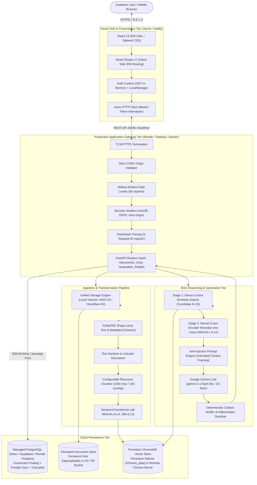

# System Architecture Specification

## 1. Production Architecture Overview

DocuRAG (academic title: **AI-Powered Intelligent Document Question Answering System Using Retrieval-Augmented Generation**) is built as a cloud-ready, decoupled multi-tier architecture designed for verifiable, document-grounded question answering with strict multi-tenant isolation.

---

## 2. Logical Component Design

### 2.1 Presentation Tier (React 19 + Vite)
- **Framework**: React 19 single-page application bundled with Vite.
- **Styling**: Tailwind CSS with custom academic palette and responsive breakpoints (mobile, tablet, desktop).
- **Client Routing**: React Router v7 with protected routes (`ProtectedRoute`, `PublicOnlyRoute`) and direct SPA fallback rewrite support via `vercel.json`, `_redirects`, and `nginx.conf`.
- **API Client**: Centralized Axios client (`src/config/api.js`, `src/services/api.js`) dynamically targeting `VITE_API_BASE_URL` with automatic Bearer token injection and global 401 session expiry interceptors.

### 2.2 Application Gateway Tier (FastAPI)
- **Framework**: FastAPI (ASGI) running on Uvicorn with dynamic `$PORT` binding.
- **Security Middleware**:
  - **Rate Limiting**: In-memory sliding-window limiter enforcing 60 req/min on heavy endpoints (`/api/chat`, `/api/documents/upload`, `/api/evaluation/run-benchmark`).
  - **Request Tracing**: Generates or propagates `X-Request-ID` across all request/response cycles.
  - **Security Headers**: Injects `X-Content-Type-Options: nosniff`, `X-Frame-Options: DENY`, `Referrer-Policy: strict-origin-when-cross-origin`, and `X-Response-Time-Ms`.
  - **Production Exception Sanitization**: Intercepts unhandled exceptions, logs full stack traces server-side with structured logging, and returns safe, sanitized error payloads (`{"detail": "Internal server error. Please try again later."}`).
- **Health Probes**:
  - `GET /api/health` — Deep diagnostic probe checking Relational DB connectivity, ChromaDB collection status, embedding and reranker model configurations.
  - `GET /api/health/live` — Lightweight container liveness check.
  - `GET /api/health/ready` — Container dependency readiness check for Kubernetes/Docker orchestrators.

### 2.3 Document Storage Abstraction (`BaseStorageProvider`)
To ensure documents survive ephemeral container restarts in cloud environments, DocuRAG implements a modular storage provider:
- **`LocalStorageProvider`**: Writes to designated persistent directory (e.g. `/app/uploads` Docker volume or Render persistent disk). Enforces strict path-traversal prevention.
- **`S3StorageProvider`**: Uploads and manages documents in S3-compatible cloud object stores (AWS S3, Cloudflare R2, Supabase Storage S3-compatible API, MinIO). Features a local caching mechanism so PyMuPDF can inspect pages locally without repeated network round-trips.

### 2.4 Multi-Dialect Relational Database (`DatabaseManager`)
- **Dual Dialect Support**:
  - **PostgreSQL**: Production mode (when `DATABASE_URL` starts with `postgres://` or `postgresql://`). Connects via SQLAlchemy with `psycopg` driver, connection pooling (`pool_size=10, max_overflow=20, pool_pre_ping=True, pool_recycle=300`), foreign key constraints with `ON DELETE CASCADE`, and performance indexes.
  - **SQLite**: Local development and automated testing mode (when `DATABASE_URL` is `sqlite:///...` or omitted). Provides zero-configuration setup for offline development.
- **Tables**:
  - `users`: User authentication, credentials (bcrypt), timestamps.
  - `documents`: Document metadata, owner foreign key, page counts, chunk counts, storage path.
  - `chat_sessions`: Conversation sessions, user foreign key, timestamps.
  - `chat_session_documents`: Many-to-many relationship binding documents to specific sessions.
  - `messages`: Chronological conversation turns, session foreign key, citations JSON.

### 2.5 Vector Database & Dense Embeddings
- **ChromaDB**:
  - **Local Persistent Mode**: Stores collections in persistent directory (`settings.CHROMA_PERSIST_DIRECTORY`).
  - **Remote Client Mode**: If `CHROMA_HOST` and `CHROMA_PORT` are configured, connects via `chromadb.HttpClient` with optional SSL and Bearer authentication headers.
- **Embedding Model**: `sentence-transformers/all-MiniLM-L6-v2` produces 384-dimensional dense vectors normalized using L2 norm. The model is initialized as a singleton upon application startup to eliminate repetitive loading latencies.

### 2.6 Two-Stage Retrieval & Neural Cross-Encoder Reranking
1. **Stage 1 (Bi-Encoder Retrieval)**: Performs dense cosine vector search in ChromaDB, retrieving initial candidate pool (default $K_1 = 15$). Multi-document queries apply document balancing to prevent single-document starvation.
2. **Stage 2 (Cross-Encoder Reranking)**: Scores candidate chunks against the user question using `cross-encoder/ms-marco-MiniLM-L-6-v2` with joint cross-attention. Selects the top $K_2 = 5$ highest-scoring chunks.
3. **Similarity Thresholding**: Questions lacking relevant context below threshold $\tau = 0.15$ trigger safe abstention without invoking the generative LLM.

### 2.7 Generative LLM & Hallucination Defense
- **Model**: Google Gemini API (`gemini-3.1-flash-lite`, with fallback to `gemini-3.5-flash-lite` and `gemini-3.5-flash`).
- **Prompt Injection Defense**: Retrieved document text is strictly delimited and framed as **UNTRUSTED EVIDENCE**. System instructions mandate that model commands embedded within documents be ignored and never disclose system prompts, credentials, or API keys.
- **Citation Sanitization**: Post-processes generated answers against the exact retrieved chunks to strip hallucinated source brackets (e.g. references to non-existent `[6]`).
