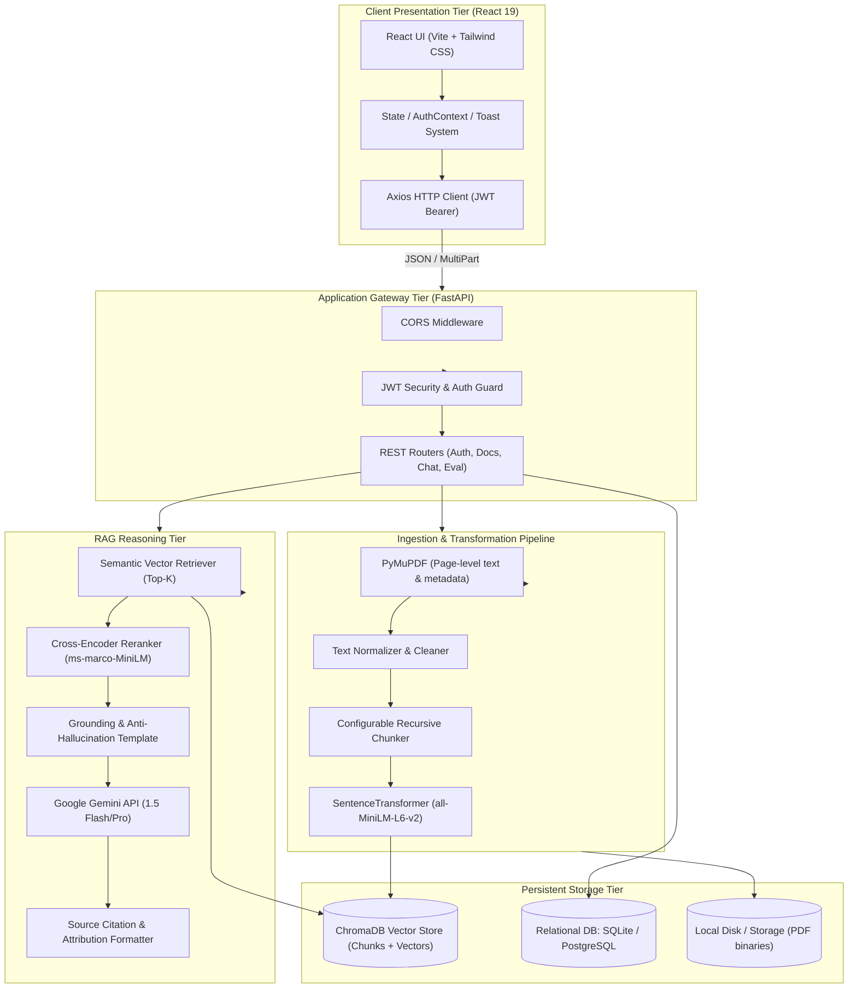

# System Architecture Specification

## 1. Overview
RAGMate is structured as a decoupled multi-tier web application adhering to the **Retrieval-Augmented Generation (RAG)** architecture for document question answering.

---

## 2. Component Design

### 2.1 PDF Ingestion Pipeline
- **Validation**: Strict verification of file magic bytes, MIME type (`application/pdf`), and file size limits (<= 25 MB).
- **Text Extraction**: Uses `PyMuPDF` (`fitz`), iterating page-by-page to record exact page indices (1-indexed for academic user presentation).
- **Text Normalization**: Strips excessive whitespace, non-printable characters, and orphaned line breaks while preserving sentence boundaries.
- **Chunking**: Implements a sliding window chunking algorithm with parameterized `chunk_size` (800–1200 characters) and `chunk_overlap` (100–200 characters). Each chunk is assigned a deterministic ID:
  `doc_{doc_id}_p{page_num}_c{chunk_index}`
  and is attached to metadata: `{document_id, document_name, page_number, user_id, chunk_index}`.

### 2.2 Embedding & Vector Store
- **Embedding Model**: `sentence-transformers/all-MiniLM-L6-v2` produces 384-dimensional dense vectors normalized using L2 norm. The model is initialized as a singleton upon application startup to eliminate repetitive loading latencies.
- **Vector DB**: ChromaDB running in persistent mode (`./chroma_data`). Supports cosine similarity indexing and metadata filtering (`{"user_id": current_user_id}`).

### 2.3 Retrieval & Reranking
- **First-Stage Retrieval**: Dense vector similarity search returning top $K_1$ candidates (default: 10–20 candidates).
- **Second-Stage Reranking (Optional)**: Cross-Encoder model scoring $(query, candidate\_text)$ pairs to select top $K_2$ most relevant contexts (default: 3–5 chunks).
- **Similarity Thresholding**: If the top retrieved candidate has a similarity score below the minimum threshold $\tau = 0.35$, the query is classified as unanswerable.

### 2.4 Grounded Prompting & Hallucination Defense
- Prompts explicitly instruct Gemini to act as a grounded document assistant, refusing to answer queries not supported by the supplied context.
- Answers are accompanied by exact citations linked to document name and page number.
